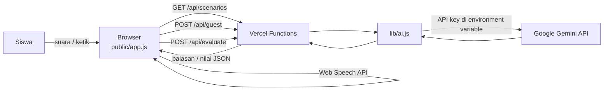

# SapaTamu

Latihan berbicara bahasa Inggris untuk profesi pariwisata di Bali, dengan lawan bicara yang diperankan AI.

**Deployment URL:** https://sapatamu-green.vercel.app

## Description

SapaTamu adalah aplikasi web untuk siswa SMA/SMK dan calon pekerja pariwisata di Bali. Siswa memilih bidang, profesi, dan kasus, lalu berlatih menangani situasi kerja nyata dalam bahasa Inggris. AI berperan sebagai tamu, pelanggan, rekan kerja, atau klien sesuai kasus. Siswa menjawab dengan suara atau ketikan. Setelah percakapan selesai, AI memberi nilai berdasarkan rubrik, ringkasan, dan contoh kalimat yang lebih baik yang bisa didengarkan.

Cakupan saat ini: **8 bidang, 60 profesi, dan 120 kasus latihan**.

## Problem & Target User

**Masalah**
- Banyak lulusan SMA/SMK di Bali langsung bekerja di sektor pariwisata, tetapi kesempatan berlatih berbicara dengan tamu asing di sekolah sangat terbatas.
- Latihan speaking di kelas dibatasi waktu dan jumlah siswa per kelas, sehingga setiap siswa hanya mendapat sedikit giliran berbicara dan sedikit umpan balik.
- Pelajaran bahasa Inggris umum belum tentu terfokus pada situasi kerja pariwisata, misalnya menangani komplain, reservasi yang hilang, atau menjelaskan etika budaya Bali.
- Aplikasi latihan bahasa Inggris global memakai skenario umum, berbayar, dan tidak memuat konteks Bali.

**Pengguna**
- **Utama:** siswa SMA/SMK di Bali yang akan bekerja di sektor pariwisata.
- **Sekunder:** lulusan baru dan pekerja muda pariwisata.
- **Pendukung:** guru bahasa Inggris dan guru produktif pariwisata yang membutuhkan alat latihan tambahan.

## Key Features

Semua fitur berikut sudah berfungsi pada versi yang disubmit:

1. **Pilih bidang → profesi → kasus.** 8 bidang (perhotelan, kuliner, usaha layanan pariwisata, kecantikan dan spa, transportasi wisata, objek wisata dan rekreasi, pemasaran digital pariwisata, pendukung pariwisata), 60 profesi, dan 2 kasus per profesi.
2. **Kartu tugas.** Sebelum percakapan, siswa melihat situasi kasus dan tugasnya: identifikasi masalah, kumpulkan informasi, susun langkah sesuai SOP, komunikasikan solusi, dan jelaskan alasannya.
3. **Lawan bicara AI.** AI membuka percakapan sesuai kasus, memerankan orang yang paling realistis dalam situasi itu, tidak langsung membuka semua detail masalah, dan bereaksi sesuai sikap siswa.
4. **Input suara dan ketik.** Siswa menjawab lewat mikrofon (speech-to-text), atau mengetik sebagai cadangan. Balasan AI dibacakan dengan suara (text-to-speech).
5. **Penilaian AI berbasis rubrik.** Empat kriteria berskala 1-4 (tata bahasa dan kosakata, bahasa layanan, penyelesaian masalah, kejelasan), skor total 0-100, ringkasan, kelebihan, dan maksimal 3 contoh kalimat perbaikan dengan tombol 🔊 Dengarkan.
6. **Konfirmasi saat berpindah kasus.** Kalau siswa sudah menjawab tetapi belum dinilai, muncul dialog untuk melanjutkan, melihat nilai dulu, atau pindah tanpa nilai.
7. **Penanganan kegagalan.** Batas waktu tunggu, pesan error yang jelas, jawaban siswa dikembalikan ke kolom ketik bila gagal terkirim, dan cadangan model AI otomatis.
8. **Tampilan responsif** untuk HP dan laptop.

## Tech Stack

| Bagian | Teknologi |
|---|---|
| Frontend | HTML, CSS, dan JavaScript tanpa framework |
| Backend | Vercel Serverless Functions (Node.js) di folder `api/` |
| Database | Tidak ada. Percakapan hanya disimpan sementara di memori browser |
| AI | Google Gemini API melalui library `@google/genai` |
| Suara | Web Speech API bawaan browser (SpeechRecognition dan speechSynthesis) |
| Hosting | Vercel |

## AI Implementation

| Komponen | Model / Metode | Input | Output | Lokasi kode |
|---|---|---|---|---|
| Lawan bicara AI | Gemini (`gemini-3.5-flash-lite`, cadangan `gemini-flash-lite-latest` dan `gemini-3.6-flash`) | Data profesi dan kasus, instruksi peran, riwayat percakapan | Balasan 1-3 kalimat dalam bahasa Inggris (sekitar CEFR B1), dan tanda `[END]` bila masalah selesai | `api/guest.js` |
| Penilai AI | Gemini dengan output JSON (`responseMimeType: application/json`) | Peran siswa, kasus, tugas, dan transkrip percakapan | Skor 1-4 per kriteria, ringkasan, kelebihan, dan kalimat perbaikan | `api/evaluate.js` |
| Speech-to-text | Web Speech API (`en-US`) | Suara siswa | Teks jawaban | `public/app.js` |
| Text-to-speech | Web Speech API (`speechSynthesis`) | Teks balasan AI dan kalimat perbaikan | Suara | `public/app.js` |

**Kenapa memakai AI:** percakapan bersifat terbuka. Jawaban siswa tidak bisa diperkirakan, sehingga tidak mungkin ditangani dengan skenario if-else biasa. AI memungkinkan lawan bicara bereaksi secara wajar terhadap jawaban apa pun, dan memberi umpan balik individual untuk setiap siswa.

**Cara kerja dan pengamanan:**
- Semua pemanggilan AI terpusat di `lib/ai.js` (fungsi `tanyaAI`). Penyedia AI bisa diganti lewat `AI_PROVIDER` tanpa mengubah kode lain. Integrasi Claude API (`@anthropic-ai/sdk`) tersedia sebagai pilihan, tetapi tidak aktif di versi deploy.
- Model dicoba berurutan sesuai `GEMINI_MODELS`. Kalau satu model sibuk atau gagal, server otomatis mencoba model berikutnya. Batas waktu 10 detik per model.
- Skor total dihitung di server dari skor per kriteria, bukan oleh AI. Nilai di luar 1-4 dirapikan sebelum ditampilkan.
- Prompt penilai diminta tidak menghukum kesalahan yang jelas berasal dari transkripsi suara.
- Validasi input di server: id kasus harus valid, riwayat maksimal 30 pesan (lawan bicara) atau 40 pesan (penilai), dan setiap pesan dipotong maksimal 500 karakter. Percakapan otomatis ditutup setelah 10 giliran siswa.
- Teks dari AI ditampilkan dengan `textContent`, sehingga tidak dijalankan sebagai kode.
- Laporan nilai selalu disertai disclaimer bahwa nilai adalah umpan balik latihan, bukan nilai resmi.

## Architecture / Data Flow



1. Browser memuat daftar bidang, profesi, dan kasus dari `GET /api/scenarios`.
2. Saat kasus dipilih, browser memanggil `POST /api/guest` dengan riwayat kosong, lalu AI membuka percakapan.
3. Setiap jawaban siswa dikirim ke `POST /api/guest` bersama riwayat percakapan. Server menyusun instruksi peran dari data kasus, lalu memanggil Gemini.
4. Saat percakapan selesai, browser memanggil `POST /api/evaluate`. Server memanggil Gemini dalam mode JSON, merapikan skor, lalu mengirim laporan ke browser.
5. Tidak ada database. Riwayat percakapan hanya ada di memori browser dan hilang saat halaman dimuat ulang.

**Struktur folder**
```
api/            fungsi server: scenarios.js, guest.js, evaluate.js
lib/            ai.js (pemanggilan AI), scenarios.js (data 60 profesi dan 120 kasus)
public/         index.html, style.css, app.js, logo.svg, img/
.env.example    nama variabel lingkungan (tanpa nilai rahasia)
tes-gemini.js   skrip uji kecepatan dan ketersediaan model Gemini
```

## Installation / Run Instructions

Kebutuhan: Node.js 20.12 atau lebih baru, akun Vercel, dan API key Gemini dari Google AI Studio.

```bash
# 1. Install library
npm install

# 2. Siapkan environment variable
cp .env.example .env.local
#    lalu isi GEMINI_API_KEY di .env.local

# 3. Install Vercel CLI dan jalankan
npm install -g vercel
vercel dev
```

Buka `http://localhost:3000` di **Google Chrome** (disarankan, karena input suara paling stabil di Chrome).

Variabel lingkungan:

| Nama | Keterangan |
|---|---|
| `AI_PROVIDER` | `gemini` (default) atau `claude` |
| `GEMINI_API_KEY` | API key Gemini |
| `GEMINI_MODELS` | Daftar model berurutan, dipisah koma |
| `ANTHROPIC_API_KEY` | Hanya diperlukan bila `AI_PROVIDER=claude` |

Untuk deploy: isi variabel yang sama di Vercel (Settings → Environment Variables), lalu jalankan `vercel --prod`.

## Deployment URL

https://sapatamu-green.vercel.app

Gunakan Google Chrome di laptop atau Android, lalu izinkan akses mikrofon saat diminta. Mode ketik tersedia bila mikrofon tidak bisa dipakai.

## Demo Account

Tidak diperlukan. Aplikasi bisa langsung dipakai tanpa login.

## Known Limitations

- **Input suara bergantung pada browser.** Web Speech API paling stabil di Chrome (desktop dan Android). Di browser lain, input suara mungkin tidak tersedia, sehingga siswa memakai mode ketik.
- **Akurasi pengenalan suara untuk aksen siswa Bali belum diuji secara luas.** Pengujian baru dilakukan oleh pengembang.
- **Pelafalan dan kelancaran tidak dinilai.** Penilaian hanya berdasarkan teks hasil transkripsi, sehingga jeda, kecepatan, dan pelafalan tidak terukur.
- **Penilaian AI bisa keliru.** Nilai adalah umpan balik latihan, bukan nilai resmi, dan sebaiknya ditinjau guru.
- **Kuota Gemini tier gratis terbatas.** Model bisa sedang sibuk (error 503/504) atau kuota habis (429). Cadangan model otomatis mengurangi risiko ini, tetapi tidak menghilangkannya. Waktu respons yang teramati sekitar 1-7 detik.
- **Belum ada pembatasan penggunaan per pengguna,** sehingga pemakaian berlebihan bisa menghabiskan kuota API.
- **Tidak ada akun, riwayat latihan, maupun dashboard guru.** Percakapan dan nilai hilang saat halaman dimuat ulang.
- **Isi kasus disusun dengan bantuan AI dan diperiksa oleh pengembang (guru),** tetapi belum divalidasi oleh praktisi industri pariwisata.
- **Data pada tier gratis Gemini dapat digunakan Google untuk meningkatkan produknya.** Karena itu aplikasi tidak meminta data pribadi, dan siswa diingatkan untuk tidak menyebut data pribadi asli.
- **Hanya bahasa Inggris** untuk latihan percakapan.

## Third-party Resources / Credits

| Sumber | Penggunaan | Lisensi / Ketentuan |
|---|---|---|
| Google Gemini API (`@google/genai`) | Lawan bicara dan penilai AI | Ketentuan layanan Google Gemini API |
| Anthropic Claude API (`@anthropic-ai/sdk`) | Pilihan penyedia AI, tidak aktif di versi deploy | Ketentuan layanan Anthropic |
| Web Speech API | Speech-to-text dan text-to-speech | Fitur bawaan browser. Di Chrome, pengenalan suara diproses oleh layanan Google |
| Vercel | Hosting dan serverless functions | Paket Hobby |
| Plus Jakarta Sans (Google Fonts) | Huruf tampilan | SIL Open Font License |
| ChatGPT (OpenAI) | Pembuatan gambar ilustrasi dan ikon bidang di `public/img/` | Dibuat oleh pengembang menggunakan ChatGPT |
| Dokumen pemetaan profesi | Data 60 profesi dan 120 kasus di `lib/scenarios.js` | Disusun dengan bantuan ChatGPT dan diperiksa oleh pengembang. Referensi umum: BNSP, JDIH Kemnaker, Portal Kurikulum Kemendikdasmen |
| Claude (Anthropic) | AI coding assistant untuk kode, debugging, logo SVG, dan dokumentasi | Lihat [DISCLOSURE.md](DISCLOSURE.md) |

Rincian lengkap ada di [DISCLOSURE.md](DISCLOSURE.md).

## Team Members

| Nama | Peran |
|---|---|
| I Kadek Aditya Pirnanda | Peserta individu (guru). Ide produk, penyusunan dan pemeriksaan kasus latihan, pengembangan aplikasi, pengujian, dan dokumentasi |
